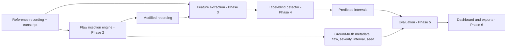
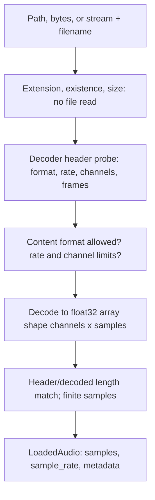
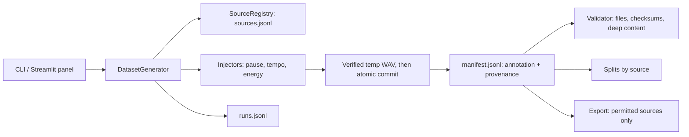

# Architecture

## End-to-end conceptual architecture (planned beyond Phase 1)

Phase 1 implements the foundation underneath every box: configuration, storage, audio input,
logging, and provenance.

## Phase 1 modules

| Module | Responsibility |
|---|---|
| `config.py` | Single definition of every setting (`_FIELDS`), loading, precedence, validation, immutable `Config` |
| `paths.py` | Resolves directories from `Config`; input/output roles; real writability checks; traversal-safe `resolve_within` |
| `validation.py` | Pure checks: extension, size, stream properties, non-finite samples |
| `audio/loader.py` | Decoder-verified `probe_audio` (header only) and `load_audio` |
| `logging_config.py` | One managed handler under the `flawbench` namespace; `log_failure` |
| `exceptions.py` | Errors with `user_message` (UI-safe) and `detail` (logs) |
| `provenance.py` | Versions, platform, config hash, optional seed |
| `status.py` | Inspects the running system for the status panel and CLI |
| `roadmap.py` | Informational phase list |
| `ui/components.py` | Rendering only |

## Configuration flow

`defaults (_FIELDS)` -> `config file` -> `environment (.env under real env)` -> `overrides` ->
coercion and validation -> frozen `Config` -> `ProjectPaths(config)`. Every other module receives the
`Config` (or one of its sections) by argument; none reads the environment or defines paths itself.

## Audio-input flow

The extension is only a first filter; the decoder decides what the bytes are, and the detected
container must match an allowed format. Nothing is resampled, normalized, trimmed, or downmixed.

## Error-handling boundaries

- Library modules raise `FlawBenchError` subclasses and never print or show UI.
- The UI boundary (`app.py`) catches `AudioInputError` and shows `public_message()`; technical
  detail goes to logs. Only `diagnostics.expose_error_details` adds detail to the UI, and it is
  rejected when `app.environment` is `production`.
- An unexpected exception at the UI boundary is logged with a traceback and replaced by a generic
  message.

## Storage conventions

| Location | Role | Behavior |
|---|---|---|
| `storage.reference_dir` | input | read-only; never created or written |
| `storage.generated_dir`, `storage.metadata_dir` | output | created and write-tested |
| `storage.output_dir` (+ `reports/`, `figures/`) | output | created and write-tested |

Uploads are never written to disk.

## Planned interfaces for later phases (contracts, not code)

- Phase 2: a generator takes `LoadedAudio`, a flaw spec, and a seed; returns modified samples plus a
  ground-truth record (flaw type, severity, interval in seconds and samples in the output
  timeline), saved under `generated_dir` / `metadata_dir` with `build_provenance(config, seed=...)`.
- Phase 3 to 4: detectors consume `LoadedAudio` only, never the ground-truth record.
- Phase 5: evaluation joins predictions and records by recording id.

## Phase 2: dataset and ground-truth engine

Module responsibilities: `params` (flaw ids, parameter specs, bounds, profile validation; shared with
config), `schema` (record shapes and timeline helpers), `io` (checksums, atomic writes, JSONL),
`registry` (rights-gated registration, integrity checks), `injectors` (pure array transforms with measured
annotations), `plan` (plan parsing and expansion), `generator` (seed derivation, identity, transaction,
batch), `validator`, `splits`, `export`.

Boundaries: generation writes audio plus annotation; a future detector receives audio only; evaluation joins
predictions and annotations afterwards. Nothing in Phase 2 reads annotations to produce predictions.

Transaction per variant: compute in memory, write temp file, decode it back and compare, re-verify the source
checksum, rename into place, rewrite the manifest atomically; on manifest failure the new file is removed (or
the previous one restored). A crash between rename and manifest leaves an orphan that the validator reports and
that regeneration adopts only if byte-identical.
