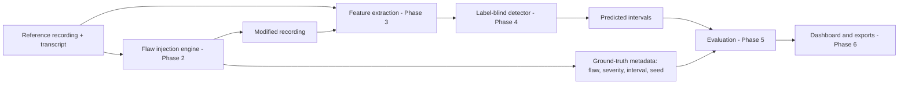
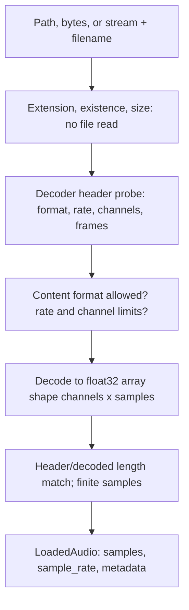
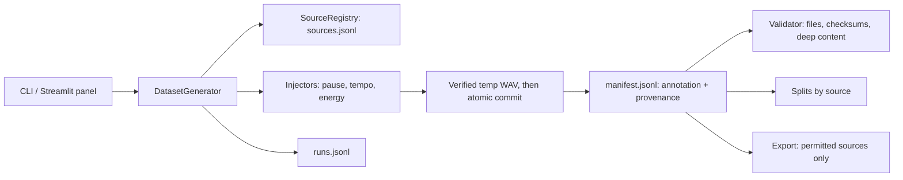
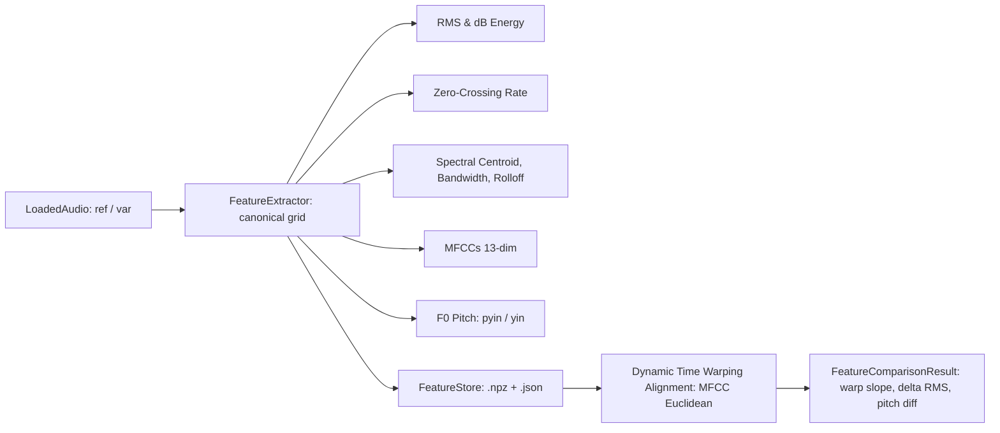

# Architecture

## End-to-end conceptual architecture (planned beyond Phase 1)



Phase 1 implements the foundation underneath every box: configuration, storage, audio input,
logging, and provenance.

## Phase 1 modules

| Module | Responsibility |
|---|---|
| `config.py` | Single definition of every setting (`_FIELDS`), loading, precedence, validation, immutable `Config` |
| `paths.py` | Resolves directories from `Config`; input/output roles; real writability checks; traversal-safe `resolve_within` |
| `validation.py` | Pure checks: extension, size, stream properties, non-finite samples |
| `audio/loader.py` | Decoder-verified `probe_audio` (header only) and `load_audio` |
| `logging_config.py` | One managed handler under the `flawbench` namespace; `log_failure` |
| `exceptions.py` | Errors with `user_message` (UI-safe) and `detail` (logs) |
| `provenance.py` | Versions, platform, config hash, optional seed |
| `status.py` | Inspects the running system for the status panel and CLI |
| `roadmap.py` | Informational phase list |
| `ui/components.py` | Rendering only |

## Configuration flow

`defaults (_FIELDS)` -> `config file` -> `environment (.env under real env)` -> `overrides` ->
coercion and validation -> frozen `Config` -> `ProjectPaths(config)`. Every other module receives the
`Config` (or one of its sections) by argument; none reads the environment or defines paths itself.

## Audio-input flow



The extension is only a first filter; the decoder decides what the bytes are, and the detected
container must match an allowed format. Nothing is resampled, normalized, trimmed, or downmixed.

## Error-handling boundaries

- Library modules raise `FlawBenchError` subclasses and never print or show UI.
- The UI boundary (`app.py`) catches `AudioInputError` and shows `public_message()`; technical
  detail goes to logs. Only `diagnostics.expose_error_details` adds detail to the UI, and it is
  rejected when `app.environment` is `production`.
- An unexpected exception at the UI boundary is logged with a traceback and replaced by a generic
  message.

## Storage conventions

| Location | Role | Behavior |
|---|---|---|
| `storage.reference_dir` | input | read-only; never created or written |
| `storage.generated_dir`, `storage.metadata_dir` | output | created and write-tested |
| `storage.output_dir` (+ `reports/`, `figures/`) | output | created and write-tested |

Uploads are never written to disk.

## Planned interfaces for later phases (contracts, not code)

- Phase 2: a generator takes `LoadedAudio`, a flaw spec, and a seed; returns modified samples plus a
  ground-truth record (flaw type, severity, interval in seconds and samples in the output
  timeline), saved under `generated_dir` / `metadata_dir` with `build_provenance(config, seed=...)`.
- Phase 3 to 4: detectors consume `LoadedAudio` only, never the ground-truth record.
- Phase 5: evaluation joins predictions and records by recording id.


## Phase 2: dataset and ground-truth engine



Module responsibilities: `params` (flaw ids, parameter specs, bounds, profile validation; shared with
config), `schema` (record shapes and timeline helpers), `io` (checksums, atomic writes, JSONL),
`registry` (rights-gated registration, integrity checks), `injectors` (pure array transforms with measured
annotations), `plan` (plan parsing and expansion), `generator` (seed derivation, identity, transaction,
batch), `validator`, `splits`, `export`.

Boundaries: generation writes audio plus annotation; detectors receive audio and label-free features only; evaluation joins
predictions and annotations afterwards. Nothing in Phase 2 reads annotations to produce predictions.

Transaction per variant: compute in memory, write temp file, decode it back and compare, re-verify the source
checksum, rename into place, rewrite the manifest atomically; on manifest failure the new file is removed (or
the previous one restored). A crash between rename and manifest leaves an orphan that the validator reports and
that regeneration adopts only if byte-identical.

## Phase 3: feature extraction & time-series analysis



Canonical frame grid: 25 ms frame length, 10 ms hop interval, centered STFT. Time index for frame `i`: `t = i * hop_seconds`. Feature artifacts are cached with audio SHA-256 and configuration fingerprint.

## Phase 4: independent speech flaw detection & ground-truth isolation

Phase 4 introduces an independent, label-blind detection layer that inspects variant speech alongside the reference and produces timestamped flaw hypotheses with measured acoustic evidence.

### Architectural Ground-Truth Isolation

```mermaid
flowchart TD
    subgraph Phase 2 Dataset Generation
        REF_REC[Reference Audio WAV]
        VAR_REC[Variant Audio WAV]
        GT[manifest.jsonl: flaw_type, severity, output_interval, source_interval]
    end

    subgraph Phase 4 Independent Detection Pipeline
        LF_IN[DetectionInput: label-free audio, features & DTW comparison]
        REF_REC --> LF_IN
        VAR_REC --> LF_IN
        
        LF_IN --> DET_P[PauseDetector: DTW freeze / silence diff]
        LF_IN --> DET_T[TempoDetector: local warp slope ratio]
        LF_IN --> DET_E[EnergyReductionDetector: aligned delta RMS]
        
        DET_P --> PP[PostProcessor: gap merge, duration filter, boundary check]
        DET_T --> PP
        DET_E --> PP
        
        PP --> RES[DetectionResult: predictions, sample intervals, evidence]
        RES --> STORE[DetectionStore: detections/ + manifest.jsonl]
    end

    subgraph Phase 5 Formal Evaluation (Deferred)
        EVAL[Evaluation Engine]
        GT -.->|Labels joined ONLY at evaluation time| EVAL
        STORE -.->|Predictions joined by sample_id| EVAL
        EVAL --> METRICS[IoU, Precision, Recall, F1]
    end

    style GT fill:#ffcccc,stroke:#cc0000,stroke-width:2px
    style LF_IN fill:#ccffcc,stroke:#009900,stroke-width:2px
```

### Isolation Guarantees

1. **No Label Flow**: The `DetectionInput` data structure only encapsulates audio waveforms, sample rates, durations, acoustic feature arrays, and DTW alignment curves. Ground-truth annotations (`flaw_type`, `severity`, `output_interval`, `source_interval`) are never loaded or passed into the detection engine.
2. **Annotation Invariance**: Mutating flaw annotations in `manifest.jsonl` without modifying the audio files produces byte-identical detection outputs.
3. **Forbidden Key Audit**: `DetectionValidator` scans detection result files for any forbidden ground-truth keys (`ground_truth`, `injected_interval`, `output_interval`, `source_interval`, `severity`, etc.) and rejects contaminated artifacts.
4. **Canonical Half-Open Representation**: All detected intervals are localized on the variant timeline using integer sample indices `[start_sample, end_sample)` and corresponding seconds `[start_sec, end_sec)`. Reference intervals are recorded separately only when DTW correspondence is unambiguous.
